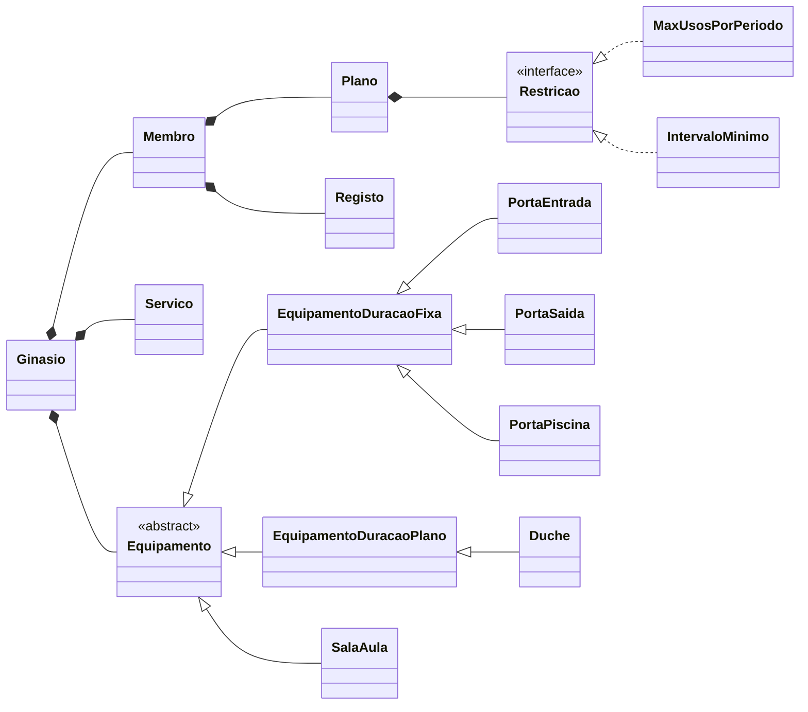

<div align="center">

# 🏋️ ESTGym

### Simulador de ginásio com controlo de acessos por planos personalizados


*1.º Trabalho Prático de **Padrões e Desenho de Software** · 2026/27*
*Licenciatura em Informática e Multimédia · Universidade Politécnica de Castelo Branco*

</div>

---

## 📖 Sobre o projeto

A **ESTGym** é uma cadeia de ginásios onde **cada ginásio define os seus próprios planos**.
Os membros passam o cartão nos equipamentos e o sistema decide, em tempo real,
se podem usar o serviço — com base no plano contratado, no histórico de utilização
e no estado de cada equipamento.

> 💡 O desafio principal: suportar **qualquer plano inventado por qualquer ginásio**
> sem alterar as classes do modelo.

---

## ✨ Funcionalidades

| | Funcionalidade | Descrição |
|---|---|---|
| 🚪 | **Controlo de entradas e saídas** | Portas que validam se o membro pode entrar ou sair |
| 📋 | **Planos configuráveis** | Ex.: *"2 por dia, 30 min entre eles"* ou *"3 vezes por semana"* |
| 🧘 | **Aulas de grupo** | Lotação máxima e entrada a meio sem reiniciar a aula |
| 🚿 | **Duches com tempo extra** | Janela de tempo para ativar o tempo adicional |
| 🏊 | **Piscina e personal trainers** | Duração definida pelo plano de cada membro |
| 🥗 | **Consultas e massagens** | Duração definida pelo ginásio |
| 📊 | **Histórico por membro** | Registo de cada serviço, equipamento e hora |
| ⏱️ | **Relógio simulado** | Acelerar o tempo para testar regras diárias, semanais e mensais |

---

## 🧠 Arquitetura



### 🎯 Decisões de desenho

- **Composição em vez de herança nos planos** — um plano é um conjunto de restrições
  reutilizáveis (`MaxUsosPorPeriodo`, `IntervaloMinimo`). Um plano novo não exige
  nenhuma classe nova.
- **Template Method nos equipamentos** — as verificações comuns ficam na classe base
  (`podeUsar` é `final`); cada equipamento só redefine o que tem de diferente.
- **Polimorfismo** — a interface gráfica trata todos os equipamentos da mesma forma,
  sem `instanceof`.
- **Separação modelo / interface** — a lógica não depende do Swing nem do relógio:
  a hora é sempre recebida por parâmetro.
- **Encapsulamento por pacote** — só os equipamentos podem alterar o estado de um membro.
- **Estado calculado** — membros e equipamentos guardam *até quando* estão ocupados,
  em vez de um booleano, por isso libertam-se sozinhos sem temporizadores.

---

## 🧪 Testes

As classes do modelo têm testes na pasta `testes/` (`TesteServico`, `TesteMembro`,
`TesteEquipamento`), que cobrem as validações, os casos limite de tempo, as restrições
dos planos, o tempo extra do duche e a lotação das aulas.

A configuração de teste do enunciado (6 membros, 18 equipamentos e respetivos planos)
é criada em `menu.Arranque`.

---

## 🚀 Como executar

```bash
git clone https://github.com/CLopes86/ESTGym.git
```

1. Abrir no **Eclipse** → *File → Import → Existing Projects into Workspace*
2. Garantir **Java 21**
3. Executar `menu.Arranque`

> ⚠️ A pasta de trabalho tem de ser a raiz do projeto, para carregar as imagens da pasta `art/`.

---

## 📁 Estrutura

```
ESTGym/
├── src/
│   ├── modelo/      → lógica do ginásio (membros, planos, equipamentos)
│   ├── menu/        → interface gráfica (Swing) e configuração de arranque
│   └── pds/util/    → utilitários fornecidos pelo docente
├── testes/          → testes das classes do modelo
├── art/             → ícones dos equipamentos
└── relatorio/       → relatório do trabalho
```

---

## 🗺️ Roadmap

- [x] Análise do problema e casos de uso
- [x] Diagrama de classes
- [x] Modelo: serviços, membros e registos
- [x] Planos e restrições
- [x] Equipamentos
- [x] Configuração de teste
- [x] Ligação à interface gráfica
- [x] Testes de todos os casos de uso
- [x] Relatório

---

<div align="center">

## 👨‍💻 Autor

**Cesaltino Rodrigues Lopes**

[](https://github.com/CLopes86)
[](https://www.linkedin.com/in/cesaltino-lopes)

</div>