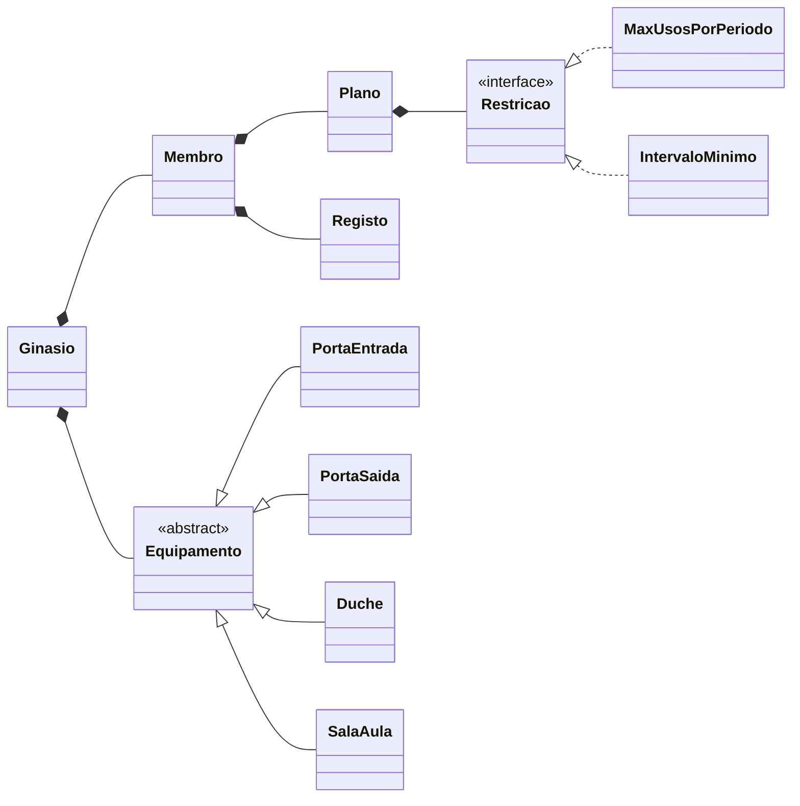

<div align="center">

# 🏋️ ESTGym

### Simulador de ginásio com controlo de acessos por planos personalizados


*1.º Trabalho Prático de **Padrões e Desenho de Software** · 2026/27*
*Licenciatura em Informática e Multimédia · Universidade Politécnica de Castelo Branco*

</div>

---

## 📖 Sobre o projeto

A **ESTGym** é uma cadeia de ginásios onde **cada ginásio define os seus próprios planos**.
Os membros passam o cartão nos equipamentos e o sistema decide, em tempo real,
se podem usar o serviço — com base no plano contratado, no histórico de utilização
e no estado de cada equipamento.

> 💡 O desafio principal: suportar **qualquer plano inventado por qualquer ginásio**
> sem escrever código novo.

---

## ✨ Funcionalidades

| | Funcionalidade | Descrição |
|---|---|---|
| 🚪 | **Controlo de entradas e saídas** | Portas que validam se o membro pode entrar ou sair |
| 📋 | **Planos configuráveis** | Ex.: *"2 por dia, 30 min entre eles"* ou *"3 vezes por semana"* |
| 🧘 | **Aulas de grupo** | Lotação máxima e entrada a meio sem reiniciar a aula |
| 🚿 | **Duches com tempo extra** | Janela de tempo para ativar o tempo adicional |
| 🏃 | **Personal trainers e consultas** | Duração definida pelo plano ou pelo ginásio |
| 📊 | **Histórico por membro** | Registo de cada serviço, equipamento e hora |
| ⏱️ | **Relógio simulado** | Acelerar o tempo para testar regras semanais e mensais |

---

## 🧠 Arquitetura



### 🎯 Decisões de desenho

- **Composição em vez de herança nos planos** — um plano é um conjunto de restrições
  reutilizáveis. Um plano novo não exige nenhuma classe nova.
- **Template Method nos equipamentos** — as verificações comuns ficam na classe base;
  cada equipamento só redefine o que tem de diferente.
- **Polimorfismo** — a interface gráfica trata todos os equipamentos da mesma forma,
  sem `instanceof`.
- **Separação modelo / interface** — a lógica não depende do Swing.
- **Encapsulamento por pacote** — só os equipamentos podem alterar o estado de um membro.

---

## 🚀 Como executar

```bash
git clone https://github.com/CLopes86/ESTGym.git
```

1. Abrir no **Eclipse** → *File → Import → Existing Projects into Workspace*
2. Garantir **Java 21**
3. Executar `menu.Arranque`

> ⚠️ A pasta de trabalho tem de ser a raiz do projeto, para carregar as imagens da pasta `art/`.

---

## 📁 Estrutura

```
ESTGym/
├── src/
│   ├── modelo/      → lógica do ginásio (membros, planos, equipamentos)
│   ├── menu/        → interface gráfica (Swing)
│   └── pds/util/    → utilitários fornecidos pelo docente
├── art/             → ícones dos equipamentos
└── relatorio/       → relatório do trabalho
```

---

## 🗺️ Roadmap

- [x] Análise do problema e casos de uso
- [x] Diagrama de classes
- [ ] Modelo: serviços, membros e registos
- [ ] Planos e restrições
- [ ] Equipamentos
- [ ] Configuração de teste
- [ ] Ligação à interface gráfica
- [ ] Testes de todos os casos de uso
- [ ] Relatório

---

<div align="center">

## 👨‍💻 Autor

**Cesaltino Rodrigues Lopes**

[](https://github.com/CLopes86)
[](https://www.linkedin.com/in/cesaltino-lopes-55274b176)

</div>